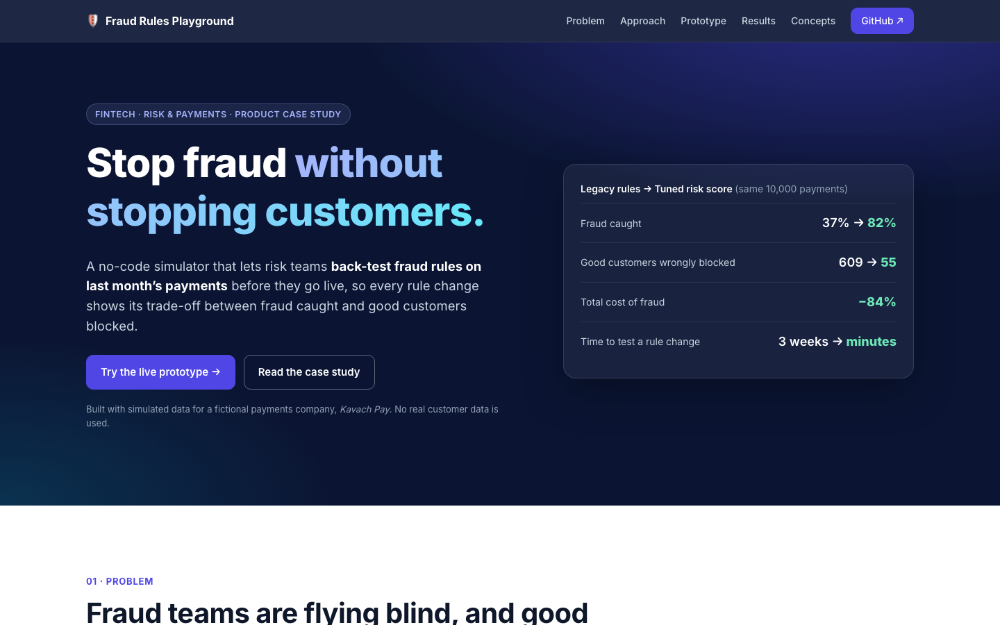
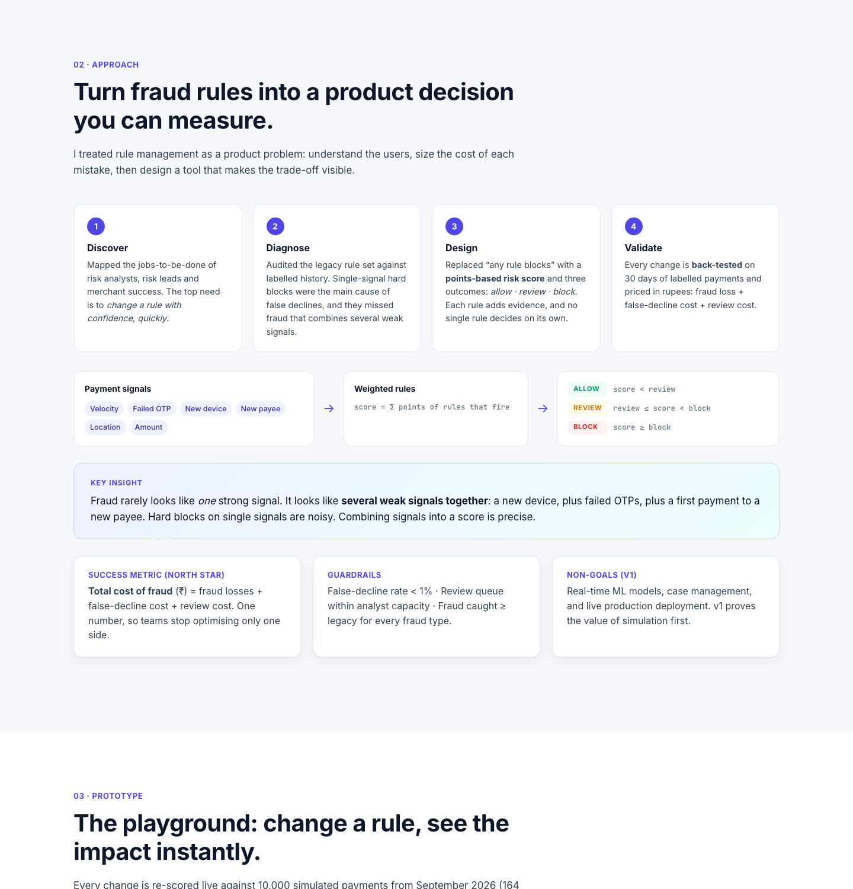
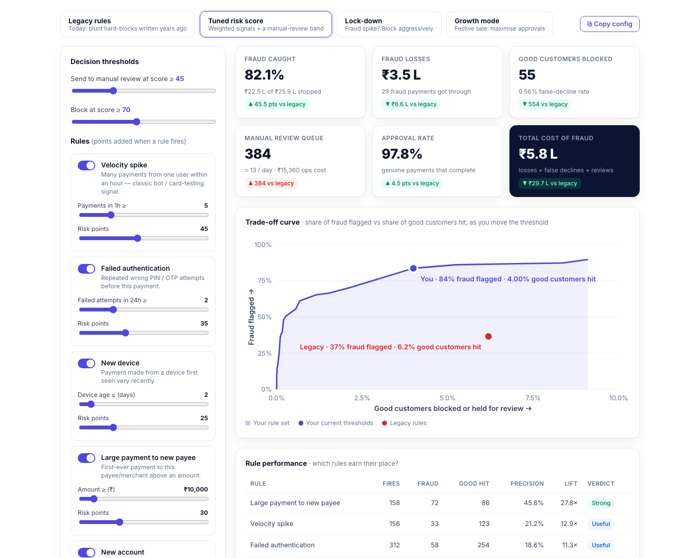
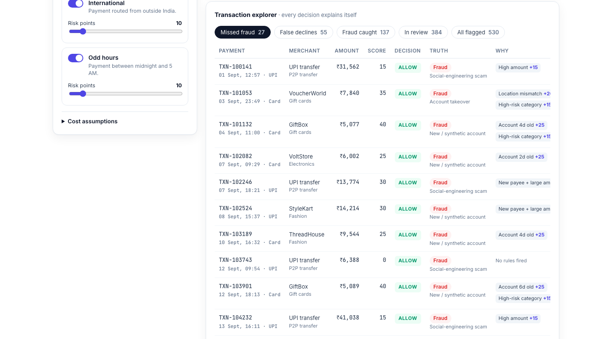
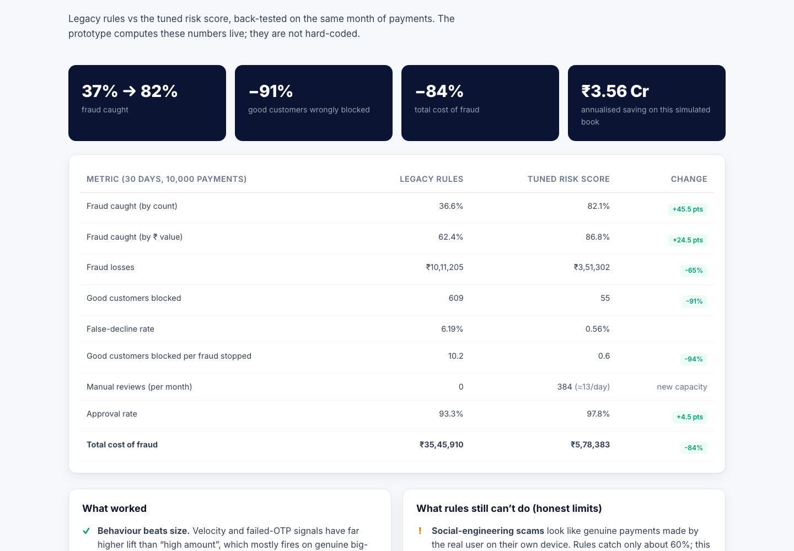

<div align="center">

# 🛡️ Fraud Rules Playground

### Stop fraud without stopping customers.

A no-code simulator that lets payment risk teams **back-test fraud rules on last month's transactions before they go live**, so every rule change shows its trade-off between *fraud caught* and *good customers blocked*.

[**▶ Live prototype**](https://aayushm1.github.io/fraud-rules-playground/) · [Product requirements (PRD)](docs/PRD.md) · [Decision log](docs/DECISIONS.md) · [Fraud & risk concepts guide](docs/CONCEPTS.md)




</div>

---

## TL;DR

| | Legacy rules | Tuned risk score | Change |
|---|---:|---:|---:|
| **Fraud caught** (by count) | 36.6% | **82.1%** | **+45.5 pts** |
| **Good customers wrongly blocked** / month | 609 | **55** | **−91%** |
| **Total cost of fraud** / month | ₹35.5 L | **₹5.8 L** | **−84%** |
| **Approval rate** | 93.3% | **97.8%** | +4.5 pts |
| **Time to test a rule change** | ~3 weeks (eng ticket) | **minutes** (self-serve) | — |

> Back-tested on 10,000 synthetic payments (30 days, 164 confirmed fraud) for **Kavach Pay**, a fictional Indian payments company. Every number above is computed live by the prototype and can be reproduced with `node scripts/report.js`.

---

## 1. The problem

Digital payments in India have grown quickly, and fraud has grown with them. Most mid-size payment companies, lenders and neobanks still defend themselves with **hard-coded "if-this-then-block" rules**. Those rules have three problems:

| Pain | What it looks like | Who feels it |
|---|---|---|
| 🚫 **Good customers get blocked** | Blunt rules like *"block anything above ₹25,000"* or *"block all international"* decline genuine customers. Industry research widely reports that **false declines cost merchants more than fraud itself**, and many declined customers never return. | Customers, merchants, growth team |
| 🐢 **Rule changes take weeks** | Every threshold tweak is an engineering ticket. During a fraud attack the risk team waits 2–3 weeks, then falls back to a blanket block. | Risk operations |
| 🎯 **No one knows which rules work** | Rules pile up over years. Nobody can say what a rule catches or how many good users it hits, so noisy rules never get retired. | Risk leadership, compliance |

**The core tension:** loose rules cost money through fraud losses and chargebacks. Tight rules cost money through lost sales, churn and review workload. Teams usually optimise one side and can't see the other.

> **Problem statement:** *How might we let risk teams design, test and safely ship fraud rules on their own, so they catch more fraud while blocking fewer genuine customers, and can measure the trade-off before going live?*

### Primary persona

**Priya, Risk Operations Lead** *(illustrative persona built from public industry pain points)*
> "When fraud spikes I can only turn rules on or off and hope. I find out whether I over-blocked when the merchant escalates, or when chargebacks arrive 45 days later."

| Jobs to be done | |
|---|---|
| When fraud spikes | *I want to* tighten the right rules within hours, *so I can* stop losses without killing conversion. |
| When growth asks for higher approvals | *I want to* show the rupee cost of each option, *so we can* agree on the trade-off with data. |
| Every quarter | *I want to* see which rules are dead weight, *so I can* retire them and reduce false declines. |

---

## 2. Approach



| Step | What I did | Output |
|---|---|---|
| **1. Discover** | Mapped jobs-to-be-done for risk analysts, risk leads and merchant success. | The top need is *changing a rule with confidence, quickly*. |
| **2. Diagnose** | Audited the legacy rule set against labelled history. | Single-signal hard blocks drive most false declines and miss fraud that combines several weak signals. |
| **3. Design** | Replaced *"any rule blocks"* with a **points-based risk score** and three outcomes: **allow · review · block**. | Each rule adds evidence; no single rule decides on its own. |
| **4. Validate** | Back-tested every configuration on 30 days of labelled payments and priced it in rupees. | One North Star metric: **total cost of fraud**. |

### How the scoring works

```
Payment signals ─► Weighted rules ─► Risk score ─► Decision
(velocity, failed OTP,   score = Σ points of       score <  review  → ALLOW
 new device, new payee,  every rule that fires     review ≤ score < block → REVIEW (analyst)
 location, amount …)                               score ≥  block   → BLOCK
```

**Key insight:** fraud rarely shows up as *one* strong signal. It shows up as **several weak signals together**, such as a new device, plus failed OTPs, plus a first payment to a new payee. Hard blocks on a single signal are noisy; combining signals into a score is precise.

### Success metrics

| Type | Metric |
|---|---|
| ⭐ **North Star** | **Total cost of fraud (₹)** = fraud losses + false-decline cost + manual-review cost |
| Primary | Fraud caught (recall, by count and ₹ value) · False-decline rate · Approval rate |
| Guardrails | False-decline rate < 1% · Review queue within analyst capacity · Fraud caught ≥ legacy for **every** fraud type |
| Adoption (post-launch) | % of rule changes shipped self-serve · Median time from idea to live rule |

---

## 3. The prototype



| Feature | Why it matters |
|---|---|
| **4 presets**: *Legacy*, *Tuned*, *Lock-down*, *Growth mode* | Shows that the right configuration depends on the business context (a fraud attack vs a festive sale). |
| **10 configurable rules**: toggle, threshold, risk points | Risk teams change rules themselves, with no engineering ticket. |
| **Allow / review / block thresholds** | A review band handles uncertain cases instead of hard-blocking them. |
| **Live KPIs vs legacy baseline** | Every change shows its impact on fraud *and* on customers. |
| **Trade-off curve** | Shows every possible threshold, so you pick a point on the curve deliberately. |
| **Rule performance table** (precision, lift, verdict) | Finds noisy rules that should be re-weighted or retired. |
| **Fraud caught by type** | Shows blind spots, e.g. social-engineering scams. |
| **Explainable transaction explorer** | Every decision lists the rules that fired and their points, which helps audits, disputes and analysts. |
| **Editable cost assumptions** | Finance can challenge the model's inputs instead of arguing about its outputs. |
| **Copy config as JSON** | The chosen rule set becomes a reviewable change request ("rules as code"). |



### The simulated dataset

10,000 payments across September 2026, generated **deterministically** in the browser (seeded RNG, so every visitor sees identical data). The dataset includes 9 merchant categories, UPI / card / netbanking, and **4 realistic fraud typologies**:

| Typology | Share | Signature in the data |
|---|---:|---|
| Account takeover | 35% | New device, repeated failed PIN/OTP, location mismatch, high-value resale goods |
| Card testing (bots) | 20% | Bursts of tiny payments, high velocity, gaming / gift cards, odd hours |
| New / synthetic account | 25% | Account < 10 days old, new device, first payment to a new merchant |
| Social-engineering scam | 20% | Genuine user on their own device paying a **new payee** a large UPI amount. It looks almost normal. |

---

## 4. Results



| Metric (30 days · 10,000 payments) | Legacy rules | Tuned risk score | Change |
|---|---:|---:|---:|
| Fraud caught (by count) | 36.6% | 82.1% | +45.5 pts |
| Fraud caught (by ₹ value) | 62.4% | 86.8% | +24.5 pts |
| Fraud losses | ₹10,11,205 | ₹3,51,302 | −65% |
| Good customers blocked | 609 | 55 | −91% |
| False-decline rate | 6.19% | 0.56% | −5.6 pts |
| Good customers blocked per fraud stopped | 10.2 | 0.6 | −94% |
| Manual reviews | 0 | 384 (≈13/day) | new, small capacity |
| Approval rate | 93.3% | 97.8% | +4.5 pts |
| **Total cost of fraud** | **₹35,45,910** | **₹5,78,383** | **−84%** |

**Annualised saving on this simulated book: ≈ ₹3.56 Cr.**

### Catch rate by fraud type

| Typology | Legacy | Tuned |
|---|---:|---:|
| Account takeover | 43.9% | **94.5%** |
| Card testing (bots) | 36.4% | **99.7%** |
| New / synthetic account | 18.8% | **60.8%** |
| Social-engineering scam | 39.4% | **60.5%** |

### What I learned

1. **Behaviour beats size.** *Large payment to a new payee* (27.8× lift), *velocity* (12.9×) and *failed authentication* (11.3×) are the strongest signals. *New account* (2.7×) and *international* (3.2×) are weak on their own; they're fine as low-weight evidence and harmful as hard blocks.
2. **A small review band is cheap insurance.** About 13 reviews a day means one analyst can absorb the uncertain cases instead of the system hard-blocking them.
3. **One rupee metric aligns teams.** Risk and growth stop arguing about competing KPIs and debate the same number.

### Honest limits

- **Social-engineering scams** look like genuine payments made by the real user on their own device. Rules catch only about 60%. Closing that gap needs payee-risk intelligence (e.g. mule-account signals) and in-app warnings, not stricter thresholds.
- **Synthetic accounts** need identity and consortium signals beyond transaction data.
- **Labels arrive late.** Chargebacks land 30–90 days after a payment, so production back-tests must run on matured data.
- **Selection bias.** Blocked payments never get a label, so real back-tests need a small random hold-out set.

---

## 5. Roadmap

| Horizon | Feature | Why |
|---|---|---|
| **Next** | **Shadow mode**: run a candidate rule on live traffic, log decisions, don't act | Validates the back-test on fresh data with zero customer risk |
| **Next** | **Champion / challenger**: send 5% of traffic to a candidate rule set | Measures live performance against the current rules |
| **Later** | **Step-up authentication** instead of block in the uncertain band | Keeps conversion while adding friction only where needed |
| **Later** | **ML score as one weighted signal** | Gets ML's accuracy while rules keep decisions explainable |
| **Later** | **Approval workflow + audit log** for rule changes | Maker-checker control that regulators and auditors expect |

---

## How it's built

Zero dependencies and zero build step, so it deploys anywhere as static files.

```
fraud-rules-playground/
├── index.html            # Case study + live prototype (single page)
├── assets/
│   ├── engine.js         # Data generator, scoring engine, metrics, presets (runs in browser & Node)
│   ├── app.js            # UI: controls, KPIs, SVG chart, tables
│   └── styles.css
├── scripts/report.js     # Reproduces every number in this README
└── docs/
    ├── PRD.md            # Product requirements document
    ├── DECISIONS.md      # Key product decisions & trade-offs
    ├── CONCEPTS.md       # Fraud & risk concepts guide for fintech PMs
    └── images/
```

### Cost model (editable in the prototype)

| Assumption | Default |
|---|---:|
| Chargeback fee + ops cost per missed fraud | ₹350 |
| Analyst cost per manual review | ₹40 |
| Share of reviewed fraud stopped by analysts | 95% |
| Good customers who abandon while held for review | 8% |
| Cost per ₹1 of good payment declined (lost margin + churn) | ₹0.30 |

### Run locally

```bash
git clone https://github.com/aayushm1/fraud-rules-playground.git
cd fraud-rules-playground
python3 -m http.server 8000      # then open http://localhost:8000
node scripts/report.js           # print the results table
```

### Deploy to GitHub Pages

1. Push to a public repo named `fraud-rules-playground`.
2. **Settings → Pages → Build and deployment → Deploy from a branch → `main` / `(root)`**.
3. The site goes live at `https://aayushm1.github.io/fraud-rules-playground/`.

---

## Disclaimer

Kavach Pay is a fictional company and the persona is illustrative. **All data is synthetic.** Fraud rates, typologies and costs are simplified assumptions chosen to demonstrate product thinking. They are not benchmarks. Real fraud rates are typically much lower than the 1.6% used here, which was raised so the demo has enough fraud cases to analyse.

## Author

**Aayush Mehan**, Product Manager · [GitHub](https://github.com/aayushm1)

*Built to show how I approach fintech risk problems: define the trade-off, price it in rupees, and give operators the tools to manage it themselves.*

## License

MIT, see [LICENSE](LICENSE).
